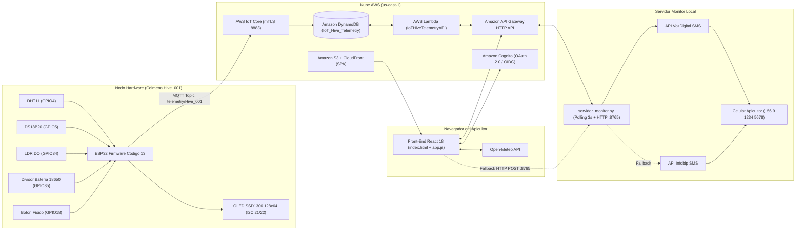
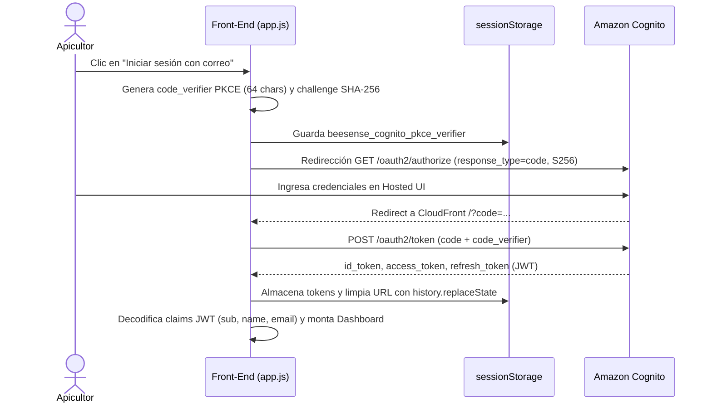
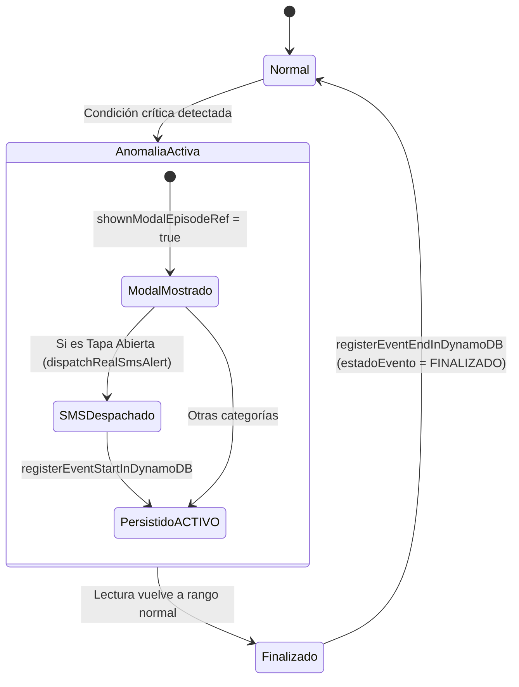
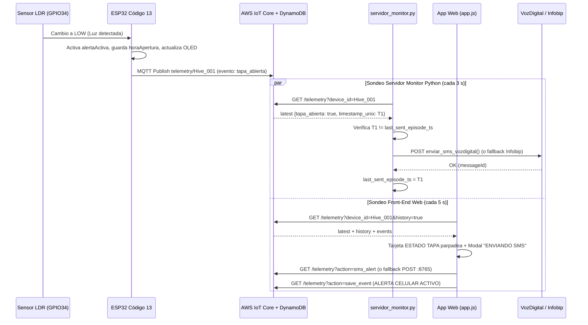

# Documentación Técnica Integral — Plataforma **BeeSense IoT**

**Directorio documentado:** `~/Escritorio/123/s3-production`  
**Dominio de aplicación:** Monitoreo Apícola IoT en Tiempo Real (*Apis mellifera*)  
**Colmenar configurado:** `Colmenar Principal - Sede PAO` (ID de dispositivo: `Hive_001`)  
**Documento complementario:** `DOCUMENTACION_BEESENSE_IoT.pdf` (maquetado con diagramas vectoriales de arquitectura, pinout, autenticación y secuencias)

---

## Tabla de Contenidos

1. [Visión General y Arquitectura del Sistema](#1-visión-general-y-arquitectura-del-sistema)
2. [Inventario Detallado de Archivos (`s3-production`)](#2-inventario-detallado-de-archivos-s3-production)
3. [Configuración Cloud, Carga Inicial y Autenticación (`index.html` y `config.js`)](#3-configuración-cloud-carga-inicial-y-autenticación-indexhtml-y-configjs)
4. [Funcionamiento Interno y Código del Front-End (`js/app.js`)](#4-funcionamiento-interno-y-código-del-front-end-jsappjs)
5. [Interfaz de Usuario (UI/UX), Diseño y Vistas](#5-interfaz-de-usuario-uiux-diseño-y-vistas)
6. [Firmware del Nodo Hardware ESP32 (`BeeSense_Codigo13_Monitoreo_Apicola_MQTT.ino`)](#6-firmware-del-nodo-hardware-esp32-beesense_codigo13_monitoreo_apicola_mqttino)
7. [Servidor Monitor y Pasarela SMS en Python (`servidor_monitor.py`)](#7-servidor-monitor-y-pasarela-sms-en-python-servidor_monitorpy)
8. [Contrato Inferido del Backend Serverless (AWS Lambda + DynamoDB)](#8-contrato-inferido-del-backend-serverless-aws-lambda--dynamodb)
9. [Auditoría Técnica, Hallazgos de Integración y Guía de Operación](#9-auditoría-técnica-hallazgos-de-integración-y-guía-de-operación)

---

## 1. Visión General y Arquitectura del Sistema

**BeeSense IoT** es una plataforma completa de telemetría ambiental y seguridad anti-apertura para colmenas de producción apícola (*Apis mellifera*), compuesta por cuatro subsistemas interconectados cuyos artefactos residen en `~/Escritorio/123/s3-production`:

1. **Nodo IoT en Terreno (ESP32 — "Código 13"):** Adquiere variables microclimáticas del apiario (temperatura interior del nido de cría, temperatura y humedad exterior), estado físico de apertura de la tapa mediante sensor de luz (LDR) y nivel de carga de batería Li-ion 18650 por divisor resistivo. Despliega los valores localmente en una pantalla OLED I2C de `128×64` píxeles y transmite la telemetría por **MQTT sobre TLS 1.2+ con autenticación mutua (mTLS, puerto `8883`)** hacia **AWS IoT Core**.
2. **Infraestructura Cloud Serverless (AWS `us-east-1`):** Recibe los mensajes desde AWS IoT Core, almacena históricos y episodios de eventos en **Amazon DynamoDB**, expone consultas y comandos mediante **Amazon API Gateway + AWS Lambda (`IoTHiveTelemetryAPI`)**, autentica usuarios con **Amazon Cognito (OAuth 2.0 / OIDC + PKCE)** y distribuye el Front-End estático desde **Amazon S3 + Amazon CloudFront**.
3. **Aplicación Web Front-End (SPA React 18 sin compilación):** Interfaz responsiva con modo claro/oscuro, panel de monitoreo en tiempo real (`polling` cada 5 s y soporte opcional WSS), gráficos históricos SVG con umbral térmico de `36 °C`, módulo de reportes con filtros avanzados y exportación oficial a PDF (`jsPDF`), módulo meteorológico agro-apícola integrado con **Open-Meteo API** (incluyendo cálculo del *Índice de Vuelo Apícola*) y sistema de alertas modales con respaldo de disparo SMS.
4. **Servidor Monitor y Puente SMS en Python (`servidor_monitor.py`):** Proceso demonio de consola sin dependencias externas que sondea continuamente API Gateway/DynamoDB cada `3.0` segundos y, en paralelo, levanta un microservidor HTTP puente en `0.0.0.0:8765`, despachando alertas SMS reales mediante **VozDigital** (proveedor primario) o **Infobip** (respaldo automático) cada vez que se detecta una apertura de tapa.

### Diagrama de Arquitectura de Extremo a Extremo



---

## 2. Inventario Detallado de Archivos (`s3-production`)

| Ruta Relativa | Tamaño | Líneas | Rol Técnico |
|---|---:|---:|---|
| `index.html` | 1.906 B | 43 | Punto de entrada HTML5 de la SPA. Carga tipografía, Tailwind CSS (CDN), React 18 UMD, jsPDF, `config.js`, `logo-base64.js` y `app.js`. |
| `404.html` | 12.013 B | 156 | Página estática de error 404 para Amazon S3 / CloudFront con fondo de panal animado, abejas SVG y detección de modo oscuro previa al renderizado. |
| `config.js` | 3.583 B | 74 | Configuración runtime desacoplada (`window.BEESENSE_CONFIG`) con parámetros de producción, API Gateway, Cognito e IoT WSS. |
| `css/styles.css` | 5.749 B | 135 | Keyframes y clases CSS personalizadas para animaciones de panal, 8 trayectorias de abejas, aleteo y alertas parpadeantes. |
| `js/app.js` | 239.583 B | 6.303 | Núcleo completo del Front-End React 18 (sin JSX): autenticación OAuth2/PKCE, polling/WSS, normalización, vistas, SVG charts, PDF y modales. |
| `js/logo-base64.js` | 96.685 B | 3 | Exporta `window.BEESENSE_LOGO_ASPECT_RATIO` (`3.2690`) y `window.BEESENSE_LOGO_BASE64` (PNG incrustado para reportes PDF). |
| `preview-fondo-cognito.html` | 3.093 B | 122 | Maqueta de pruebas visuales locales para validar `assets/fondo-cognito-animado.svg` detrás del cuadro de acceso de Cognito. |
| `servidor_monitor.py` | 15.213 B | 355 | Demonio Python 3 (solo librería estándar) de vigilancia en vivo sobre DynamoDB y microservidor HTTP puente en `:8765` para envío de SMS. |
| `ESP32/BeeSense_Codigo13_Monitoreo_Apicola_MQTT.ino` | 39.802 B | 1.518 | Firmware C++ Arduino para ESP32 con lectura de sensores, pantalla OLED SSD1306, WiFiManager, NTP y publicación MQTT/mTLS a AWS IoT Core. |
| `assets/fondo-cognito-animado.svg` | 17.182 B | 380 | Fondo vectorial SVG animado (`1920×1080`: panal, flora melífera, polen, 4 abejas) optimizado sin etiquetas `<filter>` para Amazon Cognito. |
| `assets/fondo-cognito-apicola.jpg` | 80.406 B | — | Imagen rasterizada JPEG `1920×1080` de respaldo para fondo de acceso en Cognito. |
| `assets/fondo-cognito-apicola.png` | 48.271 B | — | Imagen rasterizada PNG `1920×1080` alternativa para fondo de acceso en Cognito. |
| `assets/logo-desktop.png` | 82.2 KB | — | Logotipo PNG RGBA `596×165` para barra lateral de escritorio (tema claro) y página 404. |
| `assets/logo-desktop-dark.png` | 21.0 KB | — | Logotipo PNG RGBA `596×165` para barra lateral de escritorio (tema oscuro) y página 404. |
| `assets/logo-mobile.png` | 27.1 KB | — | Logotipo PNG RGBA `329×98` para barra superior y cajón de navegación móvil (tema claro). |
| `assets/logo-mobile-dark.png` | 17.4 KB | — | Logotipo PNG RGBA `596×165` para barra superior y cajón de navegación móvil (tema oscuro). |
| `assets/logo-login.png` | 172.4 KB | — | Logotipo isotipo+texto PNG RGBA `478×447` para favicon, pantalla de inicio de sesión y spinner de carga. |
| `assets/logo-login-dark.png` | 36.5 KB | — | Versión oscura (`478×447`) del logotipo de inicio de sesión. |

---

## 3. Configuración Cloud, Carga Inicial y Autenticación (`index.html` y `config.js`)

### 3.1. Carga de Dependencias en `index.html`

El archivo `index.html` (43 líneas) define una *Single Page Application* (SPA) pura que **no requiere paso de compilación (*build step*)** con Node/Webpack/Vite. Se despliega directamente como archivos estáticos en Amazon S3 y se distribuye vía Amazon CloudFront:

* **Metadatos y PWA visual:** `<html lang="es">`, viewport responsivo, favicon `./assets/logo-login.png` y título `"BeeSense IoT — Monitoreo Apícola Inteligente"`.
* **Tipografía:** Google Fonts `Plus Jakarta Sans` (pesos `400`, `500`, `600`, `700`, `800`).
* **Estilos:** Tailwind CSS cargado vía CDN (`https://cdn.tailwindcss.com`) con bloque `<script>` de configuración inline (`darkMode: 'class'`, extensión `fontFamily.sans` con `'Plus Jakarta Sans'`) complementado por `./css/styles.css`.
* **Motor UI:** `React 18` (`react.production.min.js`) y `ReactDOM 18` (`react-dom.production.min.js`) en compilación UMD de producción (`unpkg.com`).
* **Generación de documentos:** `jsPDF 2.5.1` (`jspdf.umd.min.js`) y `jsPDF-AutoTable 3.8.2` (`jspdf.plugin.autotable.min.js`) desde `cdnjs.cloudflare.com`.
* **Orden secuencial de carga local al pie de `<body>`:**
  1. `./config.js` -> expone globalmente `window.BEESENSE_CONFIG`.
  2. `./js/logo-base64.js` -> expone `window.BEESENSE_LOGO_ASPECT_RATIO` y `window.BEESENSE_LOGO_BASE64`.
  3. `./js/app.js` -> inicializa la lógica completa y monta `<App />` mediante `ReactDOM.createRoot(document.getElementById('root'))`.

### 3.2. Parámetros de `window.BEESENSE_CONFIG` (`config.js`)

`config.js` (74 líneas) desacopla los parámetros de infraestructura del código fuente en `js/app.js`, permitiendo cambiar endpoints o umbrales en caliente sobre S3 sin tocar la lógica React. Por principio de seguridad, **nunca almacena secretos privados** (como `VD_API_KEY` o credenciales IAM).

| Clave | Valor Actual en Producción | Descripción Técnica |
|---|---|---|
| `PRODUCTION_MODE` | `true` | Oculta simuladores, desactiva fluctuaciones sintéticas iniciales y fuerza tarjetas en estado `N/A` si no hay señal real. |
| `ENABLE_SIMULATOR` | `false` | Deshabilita cualquier generador de telemetría simulada. |
| `COLMENAR_ID` | `"Hive_001"` | Clave de partición (`device_id`) consultada en DynamoDB / API Gateway. |
| `NOMBRE_COLMENAR` | `"Colmenar Principal - Sede PAO"` | Etiqueta legible presentada en Dashboard, Reportes, alertas SMS y encabezado de PDF. |
| `BATTERY_ALERT_THRESHOLD` | `10` | Porcentaje mínimo bajo el cual la batería activa parpadeo crítico, modal prioritario y registro persistente en Reportes. |
| `DEVICE_OFFLINE_THRESHOLD_SECONDS` | `60` | Tiempo máximo (segundos) desde la última lectura válida antes de marcar el hardware como `Desconectado (N/A)`. |
| `API_BASE_URL` | `"https://<tu-api-id>.execute-api.us-east-1.amazonaws.com"` | URL base del API Gateway HTTP API (`IoT_Hive_HTTP_API`) usando la etapa por defecto (`$default`). Si se emplea una etapa con prefijo (ej. `/prod`), debe añadirse aquí. |
| `TELEMETRY_ROUTE` | `"/telemetry"` | Ruta base del recurso Lambda en API Gateway. |
| `SINGLE_ROUTE_MODE` | `true` | Multiplexa telemetría, lectura/escritura de eventos y disparo SMS mediante parámetros `action=` en una única ruta `GET` para evitar preflights CORS `OPTIONS`. |
| `POLLING_INTERVAL_MS` | `5000` | Cadencia de sondeo HTTP desde el navegador (`5.000 ms` = 5 s). |
| `COGNITO.ENABLED` | `true` | Habilita la autenticación federada OAuth 2.0 / OIDC con Amazon Cognito. |
| `COGNITO.DOMAIN` | `"<tu-cognito-domain>.auth.us-east-1.amazoncognito.com"` | Dominio del Managed Login / Hosted UI de Amazon Cognito. |
| `COGNITO.CLIENT_ID` | `"<tu-app-client-id>"` | App Client público configurado (`BeeSense-React-SPA`). |
| `COGNITO.USER_POOL_ID` | `"us-east-1_XXXXXXXXX"` | Identificador del User Pool en `us-east-1`. |
| `COGNITO.AUTHORITY` | `"https://cognito-idp.us-east-1.amazonaws.com/us-east-1_XXXXXXXXX"` | Issuer OIDC oficial del grupo de usuarios. |
| `COGNITO.REDIRECT_URI` | `"https://<tu-distribucion>.cloudfront.net/"` | URL de retorno HTTPS en CloudFront tras autenticación exitosa. |
| `COGNITO.LOGOUT_URI` | `"https://<tu-distribucion>.cloudfront.net/"` | URL de retorno HTTPS tras cierre de sesión en Cognito. |
| `COGNITO.RESPONSE_TYPE` | `"code"` | Flujo Authorization Code con PKCE automático `S256`. |
| `COGNITO.SCOPE` | `"email openid profile"` | Scopes OIDC solicitados en `/oauth2/authorize`. |
| `COGNITO.IDENTITY_PROVIDER` | `""` | Cadena vacía para emplear la interfaz nativa de Cognito en lugar de forzar un proveedor externo (Google/SAML). |
| `IOT_WSS.ENABLED` | `false` | Habilita o deshabilita el canal WebSocket WSS secundario hacia AWS IoT Core. |
| `IOT_WSS.WSS_URL` / `USE_PRESIGNED_ENDPOINT` | `""` / `false` | URL WSS directa o consulta previa al endpoint `/iot-wss-url` si se activa `IOT_WSS.ENABLED`. |
| `IOT_WSS.MQTT_TOPIC` | `"hive/Hive_001/telemetry"` | Tópico configurado para suscripción WSS (ver auditoría en Sección 9.1 respecto a `"telemetry/Hive_001"` del ESP32). |

### 3.3. Flujo de Autenticación con Amazon Cognito (OAuth 2.0 + PKCE)

Implementado en la Sección 1 de `js/app.js` (líneas 26–364) y el componente `LoginScreen` (líneas 2024–2245):

1. **Verificación inicial de sesión (`getStoredCognitoSession`):** Al montar `App`, inspecciona `sessionStorage` buscando `beesense_cognito_id_token` o `beesense_cognito_access_token`. Decodifica el segmento payload del JWT Base64URL (`decodeJwtPayload`) y valida `claims.exp` frente a `Date.now() / 1000`. Si expiró, elimina las credenciales almacenadas (`clearCognitoSessionStorage`).
2. **Inicio de sesión (`handleCognitoLogin` -> `buildCognitoAuthorizeUrlAsync`):**
   * Genera un `code_verifier` criptográficamente aleatorio de 64 caracteres (`A-Z`, `a-z`, `0-9`, `-`, `.`, `_`, `~`) con `window.crypto.getRandomValues` y lo guarda en `sessionStorage` bajo `beesense_cognito_pkce_verifier`.
   * Calcula su digest SHA-256 mediante `window.crypto.subtle.digest('SHA-256', ...)` y lo codifica en Base64URL (`code_challenge_method=S256`). Si WebCrypto no estuviera disponible (p. ej. contexto HTTP no seguro distinto de `localhost`), usa `code_challenge_method=plain`.
   * Redirige el navegador a `https://<DOMAIN>/oauth2/authorize` forzando interfaz en español (`lang=es`, `locale=es`, `ui_locales=es`).
   * Si `cognito.enabled` es `false` (modo desarrollo local sin Cognito), ejecuta una barra de progreso simulada de `2.000 ms` antes de autenticar.
3. **Recuperación ante navegación "Atrás" (`bfcache`):** En `LoginScreen`, suscriptores a `pageshow`, `popstate` y `focus` —junto con un temporizador de seguridad de `4.000 ms`— restauran `isLoading = false` si el usuario regresa desde la Hosted UI sin completar el login.
4. **Retorno desde Cognito:**
   * **Flujo Implicit (`#id_token=` / `#access_token=`):** `consumeCognitoCallbackFromUrl()` extrae los tokens del fragmento hash URL, limpia la URL mediante `window.history.replaceState` y almacena la sesión en `sessionStorage`.
   * **Flujo Authorization Code (`?code=...`):** `exchangeCognitoCodeForTokens(code)` ejecuta un `POST` a `/oauth2/token` (`Content-Type: application/x-www-form-urlencoded`) adjuntando `client_id`, `code`, `redirect_uri` y `code_verifier`, guarda `id_token`, `access_token` y `refresh_token` en `sessionStorage` y decodifica `sub`, `name`/`cognito:username` y `email` desde los *claims* JWT.
5. **Cierre de sesión (`clearCognitoSession`):** Limpia todas las llaves Cognito y `beesense_cognito_pkce_verifier` en `sessionStorage` y redirige a `/logout?client_id=...&logout_uri=...`.
6. **Inyección de cabeceras API (`buildApiHeaders`):** En solicitudes `GET`/`HEAD` **omite `Content-Type`** (añadiendo únicamente `Authorization: Bearer <token>` si hay sesión) para evitar *preflights* CORS innecesarios en API Gateway; en métodos con cuerpo utiliza `application/json` (autenticado) o `text/plain;charset=UTF-8`.



---

## 4. Funcionamiento Interno y Código del Front-End (`js/app.js`)

El archivo `js/app.js` (6.303 líneas, `239.583 B`) encapsula toda la aplicación React 18 dentro de una única función autoejecutable (`IIFE`) en modo `'use strict'`, empleando `const h = React.createElement` (y `Fragment = React.Fragment`) para construir el árbol virtual DOM sin transpilador JSX.

### 4.1. Mapa Modular de Secciones en `js/app.js`

| Sección (Comentario en código) | Rango de Líneas | Componentes / Funciones Principales | Responsabilidad |
|---|---:|---|---|
| **1. Configuración Cloud y Autenticación JWT** | 24–364 | `getRuntimeConfig`, `base64UrlEncode`, `decodeJwtPayload`, `buildCognitoAuthorizeUrlAsync`, `exchangeCognitoCodeForTokens`, `consumeCognitoCallbackFromUrl`, `buildApiHeaders` | Lectura de `BEESENSE_CONFIG`, ciclo PKCE/JWT con Cognito y construcción de cabeceras REST. |
| **2. Utilidades, Normalización y Comunicación AWS** | 367–1300 | `formatDateTimeCL`, `buildHourlySeries`, `unwrapDynamoRecord`, `normalizeTelemetryPayload`, `mapDynamoHistoryToSeries`, `evaluateTelemetryStatus`, `fetchEventsFromDynamoDB`, `registerEventStartInDynamoDB`, `registerEventEndInDynamoDB`, `dispatchRealSmsAlert`, `fetchLatestTelemetryFromAWS`, `connectAwsIotWebSocket` | Formateo horario chileno, normalización DynamoDB, evaluación de alertas/offline, REST API Gateway, fallback puente `:8765` y cliente WebSocket opcional. |
| **3. Exportación de Reportes a PDF** | 1303–1469 | `exportEventsToPDF` | Generación de informe oficial apaisado A4 mediante `jsPDF` y `AutoTable` con logotipo Base64. |
| **4. Iconografía Vectorial SVG** | 1472–1771 | `Icon` | Librería autocontenida de 39 iconos SVG inline tipificados. |
| **5. Enjambre, Login y Vista 404** | 1774–2245 | `BeeSwarmOverlay`, `LoginScreen`, `NotFound404Screen` | Fondo animado con 12 abejas SVG, tarjeta de acceso Cognito y pantalla 404 SPA. |
| **6. Navegación Adaptativa** | 2248–2562 | `Sidebar` | Panel lateral fijo de escritorio, cabecera móvil, drawer deslizable, contador de no leídos y toggle Dark Mode. |
| **7. Gráfico SVG y Dashboard** | 2565–3688 | `TemperatureTrendSVG`, `DashboardView` | Cabecera de estado, 4 tarjetas KPI reactivas, gráfico SVG `860×320` dual `<clipPath>`, tooltip interactivo y tarjetas móviles. |
| **8. Vista de Reportes** | 3691–4289 | `ReportsView` | Filtros por categoría/fechas/rango horario (incluso nocturno), exportación PDF y tabla paginada (`15` filas). |
| **9. Vista de Meteorología Apícola** | 4292–5112 | `CHILE_METEO_ZONES`, `getOpenMeteoWmo`, `getWindDirectionLabel`, `computeBeeFlightIndex`, `getDailyFlightBadge`, `MeteorologyView` | Integración Open-Meteo, 31 zonas chilenas, GPS HTML5, semáforo de vuelo actual y pronóstico a 7 días. |
| **10A. Vista de Perfil del Apicultor** *(rotulada "10.")* | 5115–5343 | `ProfileView` | Datos de cuenta Cognito y carga de avatar persistido con validación `<= 600×600 px`. |
| **10B. Modales y Footer** *(rotulada "10." por duplicado en fuente)* | 5346–5665 | `AlertModals`, `Footer` | Cola de modales excluyentes por prioridad (1–4) más modal de confirmación de salida y pie institucional. |
| **11. Componente Raíz de Producción** | 5668–6303 | `App`, montaje en `#root` | Orquestación de estado global, enrutamiento hash, guard `hasLoadedInitialCloud`, sincronizador de anomalías, intervalo `polling` y montaje final. |

### 4.2. Enrutamiento SPA y Detección de Rutas 404

* **Rutas Hash válidas (`VALID_HASH_ROUTES`):** `''`, `'#'`, `'#/'`, `'#/login'`, `'#/dashboard'`, `'#/reportes'`, `'#/meteorologia'`, `'#/cuenta'`.
* **Validación (`checkIsNotFoundRoute`):** Se evalúa tanto en el arranque como ante eventos `hashchange` y `popstate`. Activa `NotFound404Screen` retornando `true` si:
  * El hash actual no pertenece a `VALID_HASH_ROUTES` (y no corresponde a un callback OAuth de Cognito).
  * El `pathname` HTTP no es `'/'` ni finaliza en `'/index.html'`.

### 4.3. Normalización de Telemetría y Compatibilidad DynamoDB

La función `normalizeTelemetryPayload(rawInput)` (líneas 551–657) unifica cualquier formato procedente de DynamoDB Streams, API Gateway, payloads planos o WebSockets:

1. **Desempaquetado (`unwrapDynamoRecord`, líneas 483–509):** Si el registro trae un campo `body` en string JSON lo deserializa y convierte descriptores nativos de DynamoDB (`{ N: "..." }`, `{ S: "..." }`, `{ BOOL: ... }`, `{ NULL: true }`) a tipos primitivos JS.
2. **Filtro anti-esquemas heredados:** Descarta objetos que incluyan `peso_kg` o `temperatura_interna` sin contener al menos una clave vigente (`temperatura_interior_c`, `evento`, `timestamp_unix`, `bateria_lectura_valida`), exigiendo coincidencia previa con `TELEMETRY_KNOWN_KEYS`.
3. **Validación numérica y flags de sensor (`parseSensorNumber`, líneas 533–549):** Retorna `null` si el flag de validez es `false`/`"false"`, si el valor es `""`, `'N/A'`, `'NaN'`, no numérico, o se encuentra fuera de rango físico:

| Campo Normalizado | Claves de Entrada Soportadas | Rango / Valores Válidos | Flags de Validez Evaluados |
|---|---|---|---|
| `deviceId` | `device_id`, `colmenarId` | String | — |
| `tempInterior` | `temperatura_interior_c`, `tempInterior` | `-45` a `110` °C | `temperatura_interior_valida`, `temp_interior_valida` |
| `tempExterior` | `temperatura_exterior_c`, `tempExterior` | `-45` a `110` °C | `temperatura_exterior_valida`, `clima_exterior_valido` |
| `humedadExterior` | `humedad_exterior_pct`, `humedadExterior` | `0` a `100` % | `humedad_exterior_valida`, `clima_exterior_valido` |
| `bateria` | `bateria_porcentaje_estimado`, `bateria` | `0` a `150` (tope `100` %) | `bateria_lectura_valida` |
| `bateriaVoltaje` | `bateria_voltaje_v` | Numérico (V) | — |
| `estadoTapa` | `tapa_abierta`, `estadoTapa` | `'ABIERTA'`, `'Cerrada'`, `'N/A'` | `tapa_lectura_valida` |
| `eventoOrigen` | `evento` | String (`"medicion"`, `"tapa_abierta"`, etc.) | — |
| `timestamp` / `timestampMs` | `timestamp`, `timestamp_unix` | Unix (seg o ms) o ISO-8601 | `parseFlexibleTimestamp` |

*Nota sobre timestamps:* `parseFlexibleTimestamp` (líneas 511–531) detecta valores Unix en segundos (`0 < num < 1e12`, multiplicando por `1000`) frente a milisegundos o cadenas ISO-8601. Además, `normalizeTelemetryPayload` soporta valores booleanos (`true`/`false`), numéricos (`1`) y texto (`"ABIERTA"`) para `tapa_abierta`.

### 4.4. Motor de Evaluación de Estados (`evaluateTelemetryStatus`) y Guard Inicial

`evaluateTelemetryStatus(telemetry, currentNowMs)` (líneas 778–888) se ejecuta en cada render de `DashboardView` (con temporizador interno de reevaluación cada **5 segundos** para detectar caducidad aún sin nuevos paquetes) y dentro del sincronizador `syncAnomaliesWithDynamoDB`:

1. **Bloqueo de arranque (`hasLoadedInitialCloud`, líneas 5810, 6092, 6133–6155):** Mientras `hasLoadedInitialCloud` sea `false` (hasta concluir el primer `pullCloudData` real contra `API_BASE_URL`), React suprime `syncAnomaliesWithDynamoDB`, evitando falsos eventos `N/A`, modales o envíos SMS contra el placeholder inicial vacío.
2. **Detección de Hardware Desconectado / Caducidad (*Staleness*):** Si `telemetry` es nulo, `telemetry.deviceOffline === true`, falta `timestampMs`, han transcurrido más de `DEVICE_OFFLINE_THRESHOLD_SECONDS * 1000` ms (`nowMs - tsMs > 60000 ms`), o el reloj reporta una marca más de 5 minutos en el futuro (`diffMs < -300000`), retorna `deviceOffline: true` y fuerza los cuatro estados a `'NA'`.
3. **Tabla de clasificación con hardware en línea:**

| Métrica | Estado Resultante | Condición | Comportamiento Visual |
|---|---|---|---|
| **Temp. Interior** | `NA` | `null` / `NaN` | Fondo gris/rojo, parpadeo `na-blink-alert`, badge `SIN SEÑAL` |
| **Temp. Interior** | `HIGH_ALERT` | `> 36.0 °C` | Fondo rosado/rojo, parpadeo `critical-blink-alert`, badge `ALTA CRÍTICA` |
| **Temp. Interior** | `LOW_BLINK_ALERT` | `< 15.0 °C` | Fondo rosado/rojo, parpadeo `critical-blink-alert`, badge `BAJA CRÍTICA` |
| **Temp. Interior** | `NORMAL` | `15.0 °C` a `36.0 °C` | Tarjeta limpia con borde izquierdo ámbar `#D99B26` |
| **Clima Exterior** | `NA` | Temp. o humedad `null`/`NaN` | Parpadeo `na-blink-alert`, badge `SIN SEÑAL` |
| **Clima Exterior** | `NORMAL` | Ambas lecturas válidas | Borde izquierdo teal `#2A9D8F` |
| **Estado Tapa** | `NA` | Ausente o `'N/A'` | Parpadeo `na-blink-alert`, badge `SIN SEÑAL` |
| **Estado Tapa** | `OPEN_BLINK_ALERT` | `'ABIERTA'` | Fondo naranja, parpadeo `critical-blink-alert`, badge `ALERTA` |
| **Estado Tapa** | `NORMAL` | `'Cerrada'` | Borde izquierdo azul `#122B52` (ámbar en modo oscuro) |
| **Batería** | `NA` | `null` / `NaN` | Parpadeo `na-blink-alert`, badge `SIN SEÑAL` |
| **Batería** | `CRITICAL_BLINK_10` | `< 10 %` (`BATTERY_ALERT_THRESHOLD`) | Parpadeo `critical-blink-alert`, modal crítico y evento en Reportes |
| **Batería** | `LOW_ALERT_20` | `10 %` a `< 20 %` | Tarjeta rojiza de advertencia sin parpadeo ni modal |
| **Batería** | `NORMAL` | `>= 20 %` | Borde izquierdo y barra de progreso esmeralda |

### 4.5. Comunicación API Gateway (`SINGLE_ROUTE_MODE`) y Canal WebSocket (`IOT_WSS`)

Con `SINGLE_ROUTE_MODE: true` (producción), todas las operaciones viajan mediante peticiones HTTP `GET` sobre la misma ruta `/telemetry` hacia `API_BASE_URL` (`https://<tu-api-id>.execute-api.us-east-1.amazonaws.com`):

| Operación | Función en `app.js` | Modo Ruta Única (`SINGLE_ROUTE_MODE: true`) | Modo Multi-Ruta (`false`) |
|---|---|---|---|
| Leer telemetría e historial | `fetchLatestTelemetryFromAWS` | `GET /telemetry?device_id=Hive_001&colmenarId=Hive_001&limit=360&history=true&_t=...` | Igual (ante HTTP 404 prueba `/telemetry`, `/prod/telemetry`, `/dev/telemetry`, `/v1/telemetry`, `/` y cachea `resolvedActiveRoute`) |
| Listar eventos | `fetchEventsFromDynamoDB` | `GET /telemetry?action=events&device_id=...` | `GET /events?device_id=...` |
| Crear evento activo | `registerEventStartInDynamoDB` | `GET /telemetry?action=save_event&device_id=...&payload=<JSON>` | `POST /events` |
| Cerrar evento finalizado | `registerEventEndInDynamoDB` | `GET /telemetry?action=close_event&device_id=...&id=...&fechaTermino=...&isoTermino=...` | `PATCH /events/{id}` |
| Disparar alerta SMS | `dispatchRealSmsAlert` | `GET /telemetry?action=sms_alert&device_id=...&nombreColmenar=...&mensaje=...` | `POST /sms-alert` |

* **Respaldo local SMS:** En `dispatchRealSmsAlert` (líneas 1041–1112), si API Gateway falla o no devuelve `{ ok: true }`, el Front-End ejecuta automáticamente un `POST` a `http://localhost:8765/api/sms/send` dirigido al microservidor puente de `servidor_monitor.py`.
* **Canal WebSocket opcional (`connectAwsIotWebSocket`, líneas 1234–1300):** Activo cuando `IOT_WSS.ENABLED` es `true`. Resuelve la URL directamente desde `IOT_WSS.WSS_URL` o consultando `GET ${API_BASE_URL}/iot-wss-url?colmenarId=...` (si `USE_PRESIGNED_ENDPOINT` está activo). Al recibir tramas de texto extrae la subcadena JSON `{...}`, la normaliza con `normalizeTelemetryPayload` e inyecta la actualización inmediata; en caso de cierre (`ws.onclose`) programa reconexión automática cada `5.000 ms`.

### 4.6. Ciclo de Vida de Anomalías, Deduplicación y Serie Histórica

#### Ciclo de Vida de Anomalías (`syncAnomaliesWithDynamoDB`, líneas 5949–6088)
Cada vez que cambia `telemetry` con `hasLoadedInitialCloud === true`:

1. Evalúa 4 categorías independientes en `activeEventsRef.current`: `'TEMPERATURA'`, `'ALERTA CELULAR'`, `'ESTADO DE BATERIA'` y `'N/A'`.
2. **Inicio de anomalía:** Si la condición se activa y no existe evento activo en curso para esa categoría, genera el identificador `'EVT-' + Date.now() + '-' + <random4>`, muestra el modal correspondiente una única vez por episodio (`shownModalEpisodeRef`) y persiste el evento con `estadoEvento: 'ACTIVO'` y `fechaTermino: 'En curso (Activa)'` tanto en `localStorage` (`beesense_dynamodb_events_v1`) como en DynamoDB mediante `registerEventStartInDynamoDB`.
3. **Disparo SMS único por apertura (`sentSmsEpisodeRef`):** Emplea `lidEpisodeKey` (basado en `timestamp`, `timestamp_unix` o `timestampMs`) para asegurar que `dispatchRealSmsAlert` se ejecute una sola vez por episodio mientras la tapa permanezca abierta, reseteando el mapa al volver a `'Cerrada'`.
4. **Cierre de anomalía:** Al normalizarse la variable, invoca `registerEventEndInDynamoDB`, cambiando `estadoEvento` a `'FINALIZADO'` y registrando `fechaTermino` e `isoTermino`.
5. **Fusión y limpieza histórica (`mergeEventsLists` y `isLegacySeedEvent`, líneas 472–481 y 745–776):** Al sincronizar eventos remotos y locales evita reabrir episodios ya finalizados en caché local y descarta registros semilla obsoletos anteriores al corte `LEGACY_SEED_CUTOFF_MS = 1793000000000` o con prefijos `EVT-NA-1728` / `EVT-NA-1791`.



#### Agregación Horaria y Serie Base (`mapDynamoHistoryToSeries` y `buildHourlySeries`)
* `mapDynamoHistoryToSeries` (líneas 659–729) agrupa hasta `360` lecturas históricas en exactamente **10 ventanas de 1 hora** (`3.600.000 ms`) hacia atrás desde la lectura más reciente. Conserva el dato más nuevo de cada bloque horario, **salvo** si existió un pico crítico `tempInterior > 36.0 °C` y la muestra posterior es menor o igual a `36.0 °C`, evitando ocultar episodios de sobrecalentamiento.
* Ante nuevas lecturas en tiempo real (`App` líneas 6166–6194), un `useEffect` actualiza directamente la última ventana horaria del gráfico.
* Para estado inicial en modo offline/desarrollo, `buildHourlySeries` (líneas 428–451, con alias legado `buildTenMinuteSeries`) genera 10 puntos horarios nulos (`flatLine: true`) o con variación sinusoidal suave (`0.65` rad) si hubiera modo demo habilitado.

### 4.7. Exportación Oficial de Reportes a PDF (`exportEventsToPDF` + `js/logo-base64.js`)

Implementado en las líneas 1305–1469 de `js/app.js`:

* **Formato y geometría:** Hoja **A4 apaisada (`297×210 mm`)**.
* **Cabecera institucional:** Franja azul marino (`RGB(18, 43, 82)`) de `36 mm` de altura con filete inferior dorado (`RGB(212, 160, 23)`) de `1.5 mm`; insignia blanca redondeada (`64×23.5 mm` en `x=14, y=5.5`) que aloja `window.BEESENSE_LOGO_BASE64` ajustado proporcionalmente (`maxW = 58 mm`, `BEESENSE_LOGO_ASPECT_RATIO = 3.2690`, con fallback de texto `BeeSense IoT`); título `"REPORTE OFICIAL DE EVENTOS Y ALERTAS TELEMÉTRICAS IoT"`, nombre del colmenar, fecha chilena (`formatDateTimeCL`) y línea ámbar con filtros aplicados.
* **Tabla (`doc.autoTable`, `startY: 42`):** 7 columnas con anchos fijos `[10, 46, 34, 38, 63, 39, 39]` mm (`#`, `Nombre de Colmenar`, `Categoría`, `Evento`, `Descripción Detallada`, `Fecha y Hora de Inicio`, `Fecha y Hora de Término`), tema `grid`, filas alternadas (`RGB(244, 247, 251)`), mensaje vacío controlado y pie `"BeeSense 2026. — Plataforma de Monitoreo Apícola IoT — Página X"`. Exporta automáticamente el archivo `BeeSense_Reporte_Eventos_<YYYY-MM-DD-HH-MM-SS>.pdf`.

---

## 5. Interfaz de Usuario (UI/UX), Diseño y Vistas

### 5.1. Sistema Visual, Iconografía SVG y Animaciones CSS

* **Identidad visual:** Azul marino institucional (`#122B52` / `#16325B`), miel ámbar (`#D99B26` / `#F59E0B`), teal apícola (`#2A9D8F`) y fondo base `#F4F7FB` (claro) / `slate-950` (oscuro, persistido en `localStorage.beesense_dark_mode`).
* **Catálogo completo de iconos (`Icon`, líneas 1474–1771):** 39 iconos vectoriales SVG autocontenidos agrupados por dominio:
  * *Navegación y tema:* `home`, `fileText`, `user`, `logOut`, `moon`, `sun`, `menu`, `x`, `arrowLeft`, `chevronLeft`, `chevronRight`.
  * *Sensores, hardware y alertas:* `thermometer`, `droplets`, `alertTriangle`, `battery`, `batteryWarning`, `wifiOff`, `shieldAlert`, `box`, `zap`, `messageSms`.
  * *Reportes y cuenta:* `fileDown`, `calendar`, `filter`, `rotateCcw`, `clock`, `checkCircle`, `mapPin`, `smartphone`, `camera`, `trash`, `upload`.
  * *Meteorología:* `compass`, `cloudSun`, `cloud`, `cloudRain`, `wind`, `refreshCw`, `navigation`.
  * *(Observación menor de código: `MeteorologyView` en la línea 5100 solicita `name: 'info'` para el icono de la nota al pie, el cual cae en `default: return null` sin provocar errores).*
* **Animaciones CSS (`css/styles.css`, 135 líneas):**
  * `.honeycomb-animated-bg` (`honeycombShift`, `26 s`): malla hexagonal SVG data-URI con gradientes radiales y lineales ámbar en desplazamiento suave.
  * `.bee-flight-1` a `.bee-flight-8` (`13 s` a `20 s`): ocho trayectorias independientes en el fondo animado.
  * `.bee-orbit` y `.bee-hover-float`: órbita elíptica y levitación alrededor de tarjetas.
  * `.bee-wing` (`wingFlutter`, `0.12 s`): aleteo rápido continuo.
  * `.critical-blink-alert` (`1.1 s`): pulso de opacidad (`1` -> `0.42` -> `1`) y halo rojo para alertas críticas.
  * `.na-blink-alert` (`1.1 s`): pulso ámbar/rojo para sensores desconectados o sin señal (`N/A`).

### 5.2. Descripción Detallada de Pantallas y Componentes

#### A. Pantalla de Acceso (`LoginScreen`, líneas 2024–2245)
* Superposición animada `BeeSwarmOverlay` (12 abejas SVG: 8 en vuelo libre + 4 en órbita sobre panal dorado).
* Tarjeta central translúcida (`backdrop-blur-md`) con `./assets/logo-login.png` y botón `"Iniciar sesión con correo"` hacia Cognito. Durante la redirección muestra un spinner degradado ámbar-teal, barra de progreso y botón `"Volver a la pantalla principal"`.

#### B. Navegación Adaptativa (`Sidebar`, líneas 2248–2562)
* **Escritorio (`md:flex`, `w-64` / `lg:w-72`):** Barra lateral fija con `logo-desktop.png` / `logo-desktop-dark.png`, 4 rutas (`Dashboard`, `Reportes` con badge numérico rojo `unreadEventsCount`, `Meteorología`, `Mi Cuenta`), selector de tema claro/oscuro y cierre de sesión.
* **Móvil (`md:hidden`):** Cabecera fija superior con botón hamburguesa (punto rojo ante eventos no leídos), `logo-mobile.png` / `logo-mobile-dark.png` y menú deslizable lateral (*drawer*).

#### C. Vista Dashboard (`DashboardView`, líneas 2911–3688)
* **Cabecera y píldora global:** Muestra `"Monitoreo en Tiempo Real"`, nombre del colmenar y píldora de estado: **Verde** (`Sistema En Línea`), **Ámbar parpadeante** (`Alerta de Sensor (N/A)`) o **Rojo pulsante** (`Desconectado (N/A)` con cálculo humano del tiempo transcurrido en segundos, minutos u horas).
* **4 Tarjetas KPI (Grid `1 / 2 / 4` columnas):** `TEMP. INTERIOR` (`°C` + badges `ALTA CRÍTICA`/`BAJA CRÍTICA`), `CLIMA EXTERIOR` (`Temp °C | Humedad %`), `ESTADO TAPA` (`Cerrada`/`ABIERTA` + badge `ALERTA`) y `BATERÍA` (`%` + barra de progreso dinámica).
* **Gráfico de Tendencia de Temperatura (`TemperatureTrendSVG`, líneas 2567–2909):**
  * **Escritorio:** Lienzo SVG `viewBox="0 0 860 320"`, eje Y `0 °C – 50 °C` cada `5 °C` y 10 columnas horarias. Utiliza doble `<clipPath>` (`prodClipBelow36` y `prodClipAbove36`) respecto a `y36 = getY(36)`: debajo de `36 °C` el área interior es dorada (`#D99B26`) y la exterior teal (`#2A9D8F`); cualquier segmento sobre la línea discontinua de `36 °C` se recorta y colorea en **rojo `#ef4444`** con etiqueta numérica sobre el vértice. Incluye tooltip dinámico por barra vertical invisible y superposición `"Sin señal de telemetría activa"` cuando está offline.
  * **Móvil (`md:hidden`):** Resumen comparativo (`Cámara Cría`, `Exterior`, `Diferencial Δ`) y tarjetas por hora ordenadas desde la más reciente hacia atrás con barras proporcionales y marcador vertical rojo exactamente al `72%` del ancho (`36 °C / 50 °C`).

#### D. Vista de Reportes (`ReportsView`, líneas 3691–4289)
* **Filtros combinables:** Selector `Tipo de Evento` (`TODOS`, `TEMPERATURA`, `ALERTA CELULAR`, `ESTADO DE BATERIA`, `N/A`, filtrando registros heredados `ESTADO DE TAPADA`), fechas `Desde` / `Hasta`, botón `Limpiar` y switch `"Filtrar por Rango Horario"` (`Hora Desde` `08:00`, `Hora Hasta` `20:00`) con soporte explícito para intervalos que cruzan la medianoche (ej. `22:00` a `06:00`).
* **Exportación y paginación:** Botón `"Exportar a PDF"` y lista paginada de `15` registros por página diferenciando estado `"En curso (Activa)"` (píldora roja pulsante) frente a eventos finalizados (fecha/hora de término verde).

#### E. Vista de Meteorología (`MeteorologyView`, líneas 4292–5112)
* **Cobertura geográfica (`CHILE_METEO_ZONES`):** **31 zonas apícolas chilenas** ordenadas con `Melipilla (RM)` como predeterminada, seguidas por zonas de la Región Metropolitana (`Buin / Maipo`, `Talagante / Isla de Maipo`), norte grande/chico (`Arica / Lluta`, `Valle de Elqui / Vicuña`, `Ovalle / Limarí`), zona central (`San Felipe`, `Quillota`, `Casablanca`, `Rancagua`, `Rengo`, `San Fernando`, `Santa Cruz`, `Curicó`, `Talca`, `Linares`, `Cauquenes`), centro-sur (`San Carlos`, `Chillán`, `Los Ángeles`, `Angol`, `Temuco`, `Villarrica`), zona sur y austral (`Valdivia`, `La Unión`, `Osorno`, `Frutillar`, `Puerto Montt`, `Ancud / Chiloé`, `Coyhaique`, `Punta Arenas`). Además incluye el botón `"Mi GPS"` usando `navigator.geolocation.getCurrentPosition` (`enableHighAccuracy: true`, timeout `10 s`).
* **Consulta Open-Meteo:** Petición GET a `https://api.open-meteo.com/v1/forecast` con variables `current` (`temperature_2m`, `relative_humidity_2m`, `apparent_temperature`, `precipitation`, `weather_code`, `wind_speed_10m`, `wind_direction_10m`, `surface_pressure`) y `daily` a 7 días (`weather_code`, `temperature_2m_max`, `temperature_2m_min`, `precipitation_probability_max`, `wind_speed_10m_max`) con `&timezone=auto`.
* **Traducción WMO (`getOpenMeteoWmo`) y Rosa de los Vientos (`getWindDirectionLabel`):**
  * 16 rumbos cardinales (`N`, `NNE`, `NE`, ..., `NNO`) calculados cada `22.5°`.
  * Mapeo WMO: `0` (*Cielo despejado*), `1` (*Principalmente despejado*), `2` (*Parcialmente nublado*), `3` (*Nublado cubierto*), `45/48` (*Neblina / Niebla*), `51–55` (*Llovizna leve*), `56–57` (*Llovizna engelante*), `61–65` (*Lluvia moderada*), `66–67` (*Lluvia helada*), `71–77` (*Nevada*), `80–82` (*Chubascos de lluvia*), `85–86` (*Chubascos de nieve*), `>= 95` (*Tormenta eléctrica*).
* **Índice de Vuelo Apícola (*Apis mellifera*):**

| Evaluación | `computeBeeFlightIndex` (Condición Actual) | `getDailyFlightBadge` (Pronóstico 7 Días) |
|---|---|---|
| **Restringido / Crítico (Rojo)** | `temp < 12 °C` o `temp > 36 °C` o `viento >= 30 km/h` o `lluvia > 1 mm` | `maxTemp < 12 °C` o `maxWind >= 30 km/h` o `probLluvia >= 60 %` |
| **Moderado / Cautela (Ámbar)** | `temp < 15 °C` o `temp > 33 °C` o `viento > 20 km/h` o `lluvia > 0 mm` | `maxTemp < 15 °C` o `maxTemp > 33 °C` o `maxWind > 20 km/h` o `probLluvia >= 30 %` |
| **Óptimo (Verde)** | `15 °C <= temp <= 33 °C`, `viento <= 20 km/h`, `lluvia == 0 mm` | Resto de casos favorables dentro del rango térmico/eólico/pluvial |

#### F. Vista Mi Cuenta (`ProfileView`, líneas 5115–5343)
* Despliega nombre completo, correo electrónico, ID único `sub` de Cognito y estado `"Cuenta Activa y Sincronizada"`.
* Gestión de foto de perfil (`PNG`, `JPG`, `WEBP`) almacenada en `localStorage.beesense_avatar_url`, validando dimensiones mediante lectura `FileReader` + `new Image()` para rechazar imágenes mayores a **`600×600` píxeles**.

#### G. Sistema Prioritario de Modales (`AlertModals`, líneas 5348–5650)
Los modales emplean renderizado condicional excluyente en estricto orden de prioridad:
1. **Prioridad 1 — Tapa Abierta (`showLidModal`):** `"¡Alerta de Seguridad!"` con insignia `"ENVIANDO SMS"`.
2. **Prioridad 2 — Temperatura Crítica (`showTempModal`):** `"¡Alerta de Temperatura!"` (`> 36 °C` o `< 15 °C`).
3. **Prioridad 3 — Sensores Fuera de Línea (`showSensorNAModal`):** `"¡Sensores Fuera de Línea!"`.
4. **Prioridad 4 — Batería Crítica (`showBatteryModal`):** `"¡Batería Crítica!"` (`< 10 %`).
5. **Independiente (`showLogoutModal`):** `"¿Cerrar Sesión?"`.

#### H. Página `404.html` y Fondo SVG de Amazon Cognito
* `404.html`: Replica de forma autónoma el diseño de `NotFound404Screen` para responder directamente desde S3/CloudFront ante archivos inexistentes, aplicando la clase `dark` antes del primer pintado según `localStorage.beesense_dark_mode`.
* `assets/fondo-cognito-animado.svg` + `preview-fondo-cognito.html`: Fondo animado `1920×1080` sin filtros SVG (`<filter>`) para compatibilidad garantizada dentro del entorno de Cognito Managed Login.

---

## 6. Firmware del Nodo Hardware ESP32 (`BeeSense_Codigo13_Monitoreo_Apicola_MQTT.ino`)

El archivo `ESP32/BeeSense_Codigo13_Monitoreo_Apicola_MQTT.ino` (1.518 líneas) implementa el firmware **"Código 13"** en C++ (Arduino Core para ESP32).

### 6.1. Librerías Requeridas
* **Conectividad y reloj:** `<WiFi.h>`, `<WiFiManager.h>`, `<espMqttClient.h>`, `<time.h>`, `<string.h>`.
* **Pantalla y sensores:** `<Wire.h>`, `<Adafruit_GFX.h>`, `<Adafruit_SSD1306.h>`, `<DHT.h>`, `<OneWire.h>`, `<DallasTemperature.h>`.

### 6.2. Mapa de Pines (Pinout) y Hardware

| Pin ESP32 | Constante | Periférico / Sensor | Configuración Eléctrica y Lógica |
|---|---|---|---|
| `GPIO 4` | `DHTPIN` | Sensor **DHT11** | Temperatura y humedad exterior (`DHTTYPE = DHT11`). |
| `GPIO 5` | `DS18B20_PIN` | Sonda **DS18B20** (OneWire) | Temperatura interior cámara de cría (índice `0` en el bus). |
| `GPIO 18` | `BOTON_PIN` | Pulsador físico | `INPUT_PULLUP` (activo en `LOW`, debounce `200 ms`). Doble función: reset Wi-Fi al arranque / ciclado OLED y silencio de alerta. |
| `GPIO 21` / `GPIO 22` | `Wire.begin(21, 22)` | Pantalla **OLED SSD1306** `128×64` | Bus I2C (`SDA = 21`, `SCL = 22`), dirección `0x3C`, reset `-1`. |
| `GPIO 34` | `LDR_PIN` | Módulo sensor **LDR** (salida `DO`) | `INPUT`: `LOW` = presencia de luz (**Tapa Abierta**), `HIGH` = oscuridad (**Tapa Cerrada**). |
| `GPIO 35` | `BATTERY_PIN` | Batería Li-ion **18650** | ADC 12 bits (`ADC_11db`) unido a divisor resistivo `R1 = 100 kΩ` (`B+` a GPIO35) y `R2 = 100 kΩ` (GPIO35 a `B-`). |

### 6.3. Calibración de Batería Li-ion 18650 (Curva de 14 Puntos)

La función `leerVoltajeBateria()` promedia `16` lecturas con `analogReadMilliVolts(35)` espaciadas `2 ms` y aplica el factor divisor `(100000 + 100000) / 100000 = 2.0`. `actualizarBateria()` marca `bateriaLecturaValida = true` únicamente dentro del rango físico `2.5 V – 4.5 V`, y `estimarPorcentajeBateria(voltaje)` (líneas 485–510) interpola linealmente sobre la siguiente tabla de 14 puntos:

| Tensión Celda (V) | SoC Estimado (%) | Tensión Celda (V) | SoC Estimado (%) |
|---:|---:|---:|---:|
| `<= 3.20 V` | `0 %` | `3.75 V` | `50 %` |
| `3.30 V` | `5 %` | `3.80 V` | `60 %` |
| `3.45 V` | `10 %` | `3.85 V` | `70 %` |
| `3.55 V` | `15 %` | `3.90 V` | `80 %` |
| `3.60 V` | `20 %` | `4.00 V` | `90 %` |
| `3.65 V` | `30 %` | `4.10 V` | `95 %` |
| `3.70 V` | `40 %` | `>= 4.20 V` | `100 %` |

### 6.4. Flujo de Inicialización (`setup()`)

1. Inicia puerto serie a `115200 baudios`.
2. **Detección de reseteo Wi-Fi forzado:** Consulta `BOTON_PIN` (`GPIO 18`) durante los primeros `30 ms`; si se mantiene presionado (`LOW`), activa `forzarConfiguracionWiFi = true`.
3. Inicializa sensores `DHT11`, `DS18B20`, `BOTON_PIN`/`LDR_PIN` y el ADC (`analogReadResolution(12)`, atenuación `ADC_11db` en `GPIO 35`).
4. Arranca la pantalla OLED en `0x3C` (si falla entra en bucle infinito imprimendo `ERROR OLED` por Serial) y presenta el logo monocromático `logoBeeSense` (`80×64 px` en `PROGMEM`) durante 3 segundos.
5. **Conexión Wi-Fi (`conectarWiFi`):** Utiliza `WiFiManager` (`setConnectTimeout(20)`, `setConfigPortalTimeout(0)`). Si se forzó reseteo ejecuta `wm.resetSettings()`. De fallar la red guardada levanta el Access Point **`BeeSense-Config`** (clave **`BeeSense123`**) en **`192.168.4.1`** mostrando las instrucciones en la OLED, y habilita `WiFi.setAutoReconnect(true)`.
6. **Sincronización NTP:** Configura zona horaria chilena (`"CLT4CLST,M9.1.6/24,M4.1.6/24"`) contra `pool.ntp.org` y `time.nist.gov` aguardando hasta `10 s`.
7. Toma lecturas iniciales (`DHT11` asigna `0` si `NaN`; `DS18B20` asigna `0` si `DEVICE_DISCONNECTED_C`), lee batería y captura el estado inicial de `GPIO 34`, inicializando `ultimoEventoTapa` (`"tapa_abierta"` o `"tapa_cerrada"`) con `eventoTapaPendiente = true` para notificarlo apenas se conecte MQTT.
8. Invoca `configurarMQTT()` validando primero mediante `credencialesAWSCompletas()` que no existan marcadores de ejemplo `"PEGA_AQUI"`, cargando certificados sin bloquear el bucle OLED.

### 6.5. Temporización de Tareas en `loop()`

El ciclo principal finaliza con `delay(10)` y coordina tareas no bloqueantes mediante `millis()`:

| Tarea | Función / Bloque | Frecuencia / Disparador | Detalle de Operación |
|---|---|---|---|
| **Gestión MQTT/mTLS** | `gestionarMQTT()` | Cada ciclo; reconexión `5.000 ms`; envío periódico `10.000 ms` | Reconecta si Wi-Fi está listo; prioriza enviar `eventoTapaPendiente` antes que `"medicion"`. Si el buffer falla al publicar, reintenta en `1.000 ms`. |
| **Detección de Tapa (LDR)** | Lectura directa `GPIO 34` | Cada ciclo (`~10 ms`) | Registra por Serial toda transición raw en `GPIO 34` (`ultimoEstadoLDRInformado`), actualiza hora NTP, activa/desactiva `alertaActiva`, redibuja OLED e intenta publicar inmediatamente `"tapa_abierta"` o `"tapa_cerrada"`. |
| **Botón físico** | Lectura `GPIO 18` | Flanco `HIGH -> LOW` (debounce `200 ms`) | Si `alertaActiva` está activa, silencia la alerta visual regresando a pantalla `[1/4]`; en caso contrario cicla `pantalla` de `0` a `3`. |
| **Sensores climáticos** | `dht.read*()` + `sensors.requestTemperatures()` | Cada `2.000 ms` | Actualiza `temperaturaExterior`, `humedadExterior` y `temperaturaInterior` (solo sobrescribe lecturas válidas), imprime resumen Serial y refresca pantallas `1`–`3`. |
| **Lectura de batería** | `actualizarBateria()` | Cada `5.000 ms` | Promedia 16 muestras mV, aplica divisor y curva 14 puntos, valida `2.5 V – 4.5 V`. |
| **Reloj OLED** | `mostrarHoraFecha()` | Cada `1.000 ms` | Activo solo cuando `!alertaActiva && pantalla == 0`. |

### 6.6. Interfaz OLED (`128×64`) y Payload MQTT Publicado

* **Vistas OLED:** Pantalla inicial (`logoBeeSense` `80×64`), pantallas Wi-Fi (`"CONECTANDO WIFI"` / `"CONFIGURAR WIFI"`), `[1/4] HORA/FECHA` (con icono dinámico de batería proporcional al `%`), `[2/4] TEMP. EXTERIOR` (icono `dibujarTermometro`), `[3/4] HUMEDAD EXTERIOR` (icono `dibujarGota`), `[4/4] TEMP. INTERIOR` y pantalla de alerta prioritaria **`"! TAPA ABIERTA"` / `"SENSOR EXPUESTO"` + hora de apertura**.
* **Parámetros AWS IoT Core:**
  * Endpoint: `<tu-endpoint>-ats.iot.us-east-1.amazonaws.com` (puerto `8883`, `keepAlive = 30 s`, `timeout = 10 s`).
  * Thing / Client ID: `Hive_001` | Topic: `telemetry/Hive_001` (QoS `0`, `retain = false`, autorizado bajo la política IoT `BeeSenseApicolaPolicy`).
  * Seguridad: Certificados `AWS_ROOT_CA`, `AWS_DEVICE_CERT` y `AWS_PRIVATE_KEY` (cargados mediante `secrets.h` o plantilla `secrets.example.h`).
* **Formato exacto del payload JSON (buffer estático de `420 bytes`):**

```json
{
  "device_id": "Hive_001",
  "temperatura_exterior_c": 24.5,
  "humedad_exterior_pct": 48.0,
  "temperatura_interior_c": 34.2,
  "tapa_abierta": false,
  "bateria_lectura_valida": true,
  "bateria_voltaje_v": 4.02,
  "bateria_porcentaje_estimado": 91,
  "evento": "medicion",
  "timestamp_unix": 1794158300
}
```

*Nota:* `"evento"` alterna entre `"medicion"`, `"tapa_abierta"` y `"tapa_cerrada"`. Si NTP aún no ha sincronizado (`ahora <= 1000000000`), `timestamp_unix` se reporta como `0`.

---

## 7. Servidor Monitor y Pasarela SMS en Python (`servidor_monitor.py`)

El script `servidor_monitor.py` (355 líneas) está programado en **Python 3 estándar sin dependencias externas** (`sys`, `os`, `time`, `json`, `urllib.request`, `urllib.error`, `datetime`, `http.server`, `threading`), por lo que no requiere entorno virtual ni instalaciones vía `pip`.

### 7.1. Configuración y Variables de Entorno (`.env`)

Al iniciarse, `cargar_env()` lee un archivo `.env` ubicado junto al script e inyecta en `os.environ` las variables no definidas previamente (eliminando comillas simples/dobles y comentarios `#`):

| Variable de Entorno | Valor por Defecto | Propósito |
|---|---|---|
| `API_GATEWAY_URL` | `https://<tu-api-id>.execute-api.us-east-1.amazonaws.com/telemetry` | Endpoint REST consultado cada 3 segundos para obtener `latest`. |
| `DEVICE_ID` | `Hive_001` | Parámetro `?device_id=...` consultado a API Gateway. |
| `VD_API_KEY` | `""` | Clave API (`X-API-Key`) para el proveedor primario **VozDigital**. |
| `VD_TELEFONO` | `"569XXXXXXXX"` | Teléfono destino para VozDigital (prefijado automáticamente con `+`, ej. `+56912345678`). |
| `INFOBIP_BASE_URL` | `"v3r46p.api-us.infobip.com"` | Host de la API Infobip (agrega `https://` si se omite). |
| `INFOBIP_API_KEY` | `""` | Clave API (`Authorization: App <key>`) para **Infobip**. |
| `INFOBIP_DESTINO` | `VD_TELEFONO` o `"569XXXXXXXX"` | Número destino utilizado en el respaldo Infobip. |
| `INFOBIP_SENDER` | `"56224053317"` | Número remitente asignado en Infobip. |
| `PORT` | `8765` | Puerto TCP de escucha del microservidor HTTP puente local. |

### 7.2. Arquitectura Concurrente: Monitor DynamoDB + Puente HTTP Local

Al invocar `python3 servidor_monitor.py`, `main()` arranca dos flujos paralelos:

1. **Hilo secundario Daemon — Microservidor HTTP Puente (`start_local_http_server` / `LocalBridgeHandler`):**
   * Enlaza `0.0.0.0:8765` mediante `HTTPServer` (si el puerto estuviera ocupado, informa por consola y mantiene vivo el bucle monitor principal).
   * **`OPTIONS`:** Devuelve `200 OK` con CORS totalmente permisivo (`Access-Control-Allow-Origin: *`, `GET, POST, OPTIONS`, `Content-Type, Authorization`).
   * **`GET`:** Responde `200 OK` con JSON de diagnóstico `{ ok, service, device_id, destino }`.
   * **`POST` (esperado en `/api/sms/send` desde `app.js`):** Parsea `mensaje` del cuerpo JSON (default `"ALERTA!!! Tapa de colmena abierta (Colmenar Principal - Sede PAO)"`), invoca primero `enviar_sms_vozdigital(msg)` y, si retorna error, invoca `enviar_sms_infobip(msg)`. Responde HTTP `200` ante éxito o `502 Bad Gateway` si ambos fallan.

2. **Hilo principal — Bucle de Vigilancia en Vivo (`loop_monitoreo_dynamodb`):**
   * Sondea con `GET` cada `POLL_INTERVAL_SEC = 3.0` segundos (`timeout = 10 s`) a `${API_GATEWAY_URL}?device_id=${DEVICE_ID}`.
   * Evalúa apertura sobre `data["latest"]` cuando `str(latest.get("estadoTapa", "")).upper() == "ABIERTA"` o `bool(latest.get("tapa_abierta")) == True`.
   * **Deduplicación estricta por episodio:**
     * `last_reported_state` (`None`, `"CERRADA"`, `"ABIERTA"`) evita repetir impresiones idénticas en terminal y registra fecha/hora, temperatura interior y batería al abrirse la tapa o la restauración segura al cerrarse.
     * `last_sent_episode_ts` compara `ts = latest.get("timestamp") or latest.get("timestamp_unix")`. Solo ejecuta la pasarela SMS cuando `ts != last_sent_episode_ts`, actualizando `last_sent_episode_ts = ts` **únicamente tras confirmar `{ ok: True }`** (garantizando reintento automático en el siguiente ciclo de 3 s si hubo fallo transitorio de red/SMS).
   * **Recuperación ante fallos:** Captura `HTTPError`, `URLError` y excepciones inesperadas incrementando `consecutive_errors`; en el 3.er fallo seguido muestra alerta visible y al recuperar conectividad imprime confirmación. Captura `KeyboardInterrupt` para salida limpia con `Ctrl + C`.

### 7.3. Comparativa de Pasarelas SMS Implementadas

| Característica | Proveedor Primario: VozDigital (`enviar_sms_vozdigital`) | Proveedor de Respaldo: Infobip (`enviar_sms_infobip`) |
|---|---|---|
| Endpoint | `POST https://portal.vozdigital.net/api/v1/sms/send` | `POST https://<INFOBIP_BASE_URL>/sms/3/messages` |
| Autenticación | Header `X-API-Key: <VD_API_KEY>` | Header `Authorization: App <INFOBIP_API_KEY>` |
| Timeout | `12 segundos` | `15 segundos` |
| Estructura Payload | `{"phone_number": "+56...", "message": "..."}` | `{"messages": [{"sender": "...", "destinations": [{"to": "..."}], "content": {"text": "..."}}]}` |
| Criterio de Éxito | Campo JSON `success === true` | Código HTTP `2xx` sin excepción |

### Diagrama de Secuencia Ante Apertura de Tapa



---

## 8. Contrato Inferido del Backend Serverless (AWS Lambda + DynamoDB)

> [!NOTE]
> El código fuente de la función AWS Lambda `IoTHiveTelemetryAPI` y la plantilla de infraestructura AWS no forman parte de los archivos estáticos alojados en `~/Escritorio/123/s3-production`. La siguiente especificación ha sido **inferida directamente** a partir de las peticiones emitidas y respuestas procesadas por `js/app.js`, `config.js` y `servidor_monitor.py`.

* **Recurso DynamoDB:** Tabla `IoT_Hive_Telemetry` con clave de partición `device_id` (`"Hive_001"`), almacenando tanto lecturas telemétricas originadas desde la regla de AWS IoT Core como documentos de eventos/anomalías persistidos por Lambda.
* **Operaciones multiplexadas esperadas en `GET /telemetry` (etapa `$default` de HTTP API `<tu-api-id>`):**

| Parámetro `action` | Query Params Enviados por Cliente | Formato JSON Esperado en Respuesta |
|---|---|---|
| *(Omitido — telemetría)* | `device_id`, `colmenarId`, `limit=360`, `history=true` | `{ "latest": {...}, "items": [...], "events": [...] }` (o array directo / envuelto en `body` JSON de integración proxy Lambda). |
| `events` | `device_id`, `colmenarId` | `{ "events": [...] }` o `{ "items": [...] }` o array JSON de objetos evento. |
| `save_event` | `device_id`, `payload` *(JSON URI-encoded)* | Confirmación HTTP `200 OK` tras insertar el registro con `id`, `estadoEvento: "ACTIVO"` y `startTimestampMs`. |
| `close_event` | `device_id`, `id`, `fechaTermino`, `isoTermino` | Confirmación HTTP `200 OK` tras actualizar el evento a `estadoEvento: "FINALIZADO"`. |
| `sms_alert` | `device_id`, `nombreColmenar`, `mensaje` | `{ "ok": true, "messageId": "...", "telefonoMasked": "+569****5678" }` (con `VD_API_KEY` residiendo en variables de entorno de Lambda). |

---

## 9. Auditoría Técnica, Hallazgos de Integración y Guía de Operación

Durante la auditoría exhaustiva línea a línea del proyecto se identificaron detalles técnicos de integración relevantes para mantenimiento y escalamiento:

### 9.1. Hallazgos y Discrepancias Detectadas entre Módulos

1. **Doble canal potencial de disparo SMS (Python + Front-End):**
   * `servidor_monitor.py` despacha un SMS autónomo cada vez que aparece un `timestamp` nuevo con tapa abierta. Simultáneamente, si el navegador del usuario tiene sesión activa, `syncAnomaliesWithDynamoDB` llama a `dispatchRealSmsAlert()` hacia AWS Lambda (`?action=sms_alert`) y, si Lambda falla, al puente local `:8765`.
   * *Impacto:* Si AWS Lambda también tiene configurada una API key SMS activa y el monitor Python corre en paralelo, podrían enviarse **dos SMS** por el mismo evento (uno desde Lambda y otro desde Python). Se recomienda centralizar el envío en un único punto (o desactivar el disparo en Lambda cuando opere `servidor_monitor.py`).
2. **Desalineación en el Topic MQTT de WebSockets (`IOT_WSS.MQTT_TOPIC` vs ESP32):**
   * El firmware `BeeSense_Codigo13_Monitoreo_Apicola_MQTT.ino` (línea 48) publica en **`"telemetry/Hive_001"`**.
   * `config.js` (línea 72) declara `IOT_WSS.MQTT_TOPIC: "hive/Hive_001/telemetry"`.
   * *Impacto:* Nulo en producción actual mientras `IOT_WSS.ENABLED` sea `false`; al habilitar WSS en el futuro, debe igualarse a `"telemetry/Hive_001"`.
3. **Etiquetas descriptivas de sensores en `app.js` vs Hardware físico:**
   * El hardware ESP32 utiliza **DHT11** (`GPIO 4`) y **LDR** (`GPIO 34`). En `describeDisconnectedSensors` (`js/app.js` líneas 735–740), el texto descriptivo para reportes `N/A` refiere `'Temp. Exterior (DHT22)'`, `'Humedad Exterior (DHT22)'` y `'Sensor Tapa (Reed Switch)'`. Es un texto meramente informativo sin impacto lógico.
4. **Campo `telefonoMasked` entre `app.js` y `LocalBridgeHandler`:**
   * `js/app.js` (línea 1106) lee `data.telefonoMasked` en la respuesta del puente `:8765`, mientras `servidor_monitor.py` retorna `{ ok, provider, status, messageId, groupName, description }`. No genera fallo gracias al fallback `'Celular registrado'`, aunque añadir dicho campo en Python enriquecería el historial de Reportes.
5. **Credenciales TLS embebidas en el código fuente del ESP32 (`.ino`):**
   * Las líneas 52–126 de `BeeSense_Codigo13_Monitoreo_Apicola_MQTT.ino` contienen literalmente `AWS_DEVICE_CERT` y **`AWS_PRIVATE_KEY`** RSA en texto plano. Se recomienda extraerlas a un archivo `secrets.h` excluido en `.gitignore` antes de subir a repositorios compartidos.
   * *Nota de comentario:* La línea 40 del `.ino` comenta `sa-east-1`, aunque el endpoint configurado corresponde correctamente a **`us-east-1`** (`<tu-endpoint>-ats.iot.us-east-1.amazonaws.com`).
6. **Bloqueo síncrono de `DS18B20` (~750 ms cada 2 s):**
   * `sensors.requestTemperatures()` en resolución estándar de 12 bits espera la conversión de temperatura cada `intervaloSensores = 2000 ms`; una pulsación fugaz del botón físico exactamente dentro de esa ventana se atenderá al concluir la lectura.
7. **Límite de longitud URL en `SINGLE_ROUTE_MODE = true`:**
   * Serializar `payload` en la query string de peticiones `GET` (`?action=save_event&payload=...`) elimina preflights CORS en API Gateway, pero exige mantener concisos los textos de detalle de cada evento.

### 9.2. Guía Rápida de Despliegue y Puesta en Marcha

1. **Despliegue Front-End (Amazon S3 + CloudFront):**
   * Subir `index.html`, `404.html`, `config.js`, `css/`, `js/` y `assets/` al bucket S3 asociado a tu distribución de CloudFront (`https://<tu-distribucion>.cloudfront.net/`).
   * Configurar documento raíz `index.html` y página de error `404.html`.
   * Modificar umbrales, rutas API o intervalo de polling editando únicamente `config.js` e invalidando `/config.js` en CloudFront.
2. **Compilación y Puesta en Marcha del Hardware ESP32:**
   * Instalar en Arduino IDE el soporte de placas ESP32 y las librerías `WiFiManager`, `espMqttClient`, `Adafruit GFX`, `Adafruit SSD1306`, `DHT sensor library`, `OneWire` y `DallasTemperature`.
   * Configurar `secrets.h` copiando `secrets.example.h` con tus credenciales de AWS IoT Core y cargar `ESP32/BeeSense_Codigo13_Monitoreo_Apicola_MQTT.ino` por USB.
   * Al primer encendido (o manteniendo presionado el botón `GPIO 18` durante el arranque para limpiar credenciales previas), conectarse a la red Wi-Fi **`BeeSense-Config`** (clave **`BeeSense123`**) y abrir `http://192.168.4.1` para vincular la red Wi-Fi del apiario.
3. **Ejecución del Servidor Monitor y Pasarela SMS en Python:**
   * Crear un archivo `.env` en el mismo directorio que `servidor_monitor.py` (puedes basarte en `.env.example`):
     ```ini
     VD_API_KEY=tu_clave_vozdigital
     VD_TELEFONO=56912345678
     INFOBIP_API_KEY=tu_clave_infobip_opcional
     INFOBIP_DESTINO=56912345678
     ```
   * Iniciar el monitor desde consola:
     ```bash
     python3 servidor_monitor.py
     ```
   * El proceso imprimirá el estado inicial recuperado desde DynamoDB, levantará el puente HTTP en `http://0.0.0.0:8765` y disparará automáticamente las alertas SMS ante cualquier apertura de tapa. Se detiene de forma limpia mediante `Ctrl + C`.
